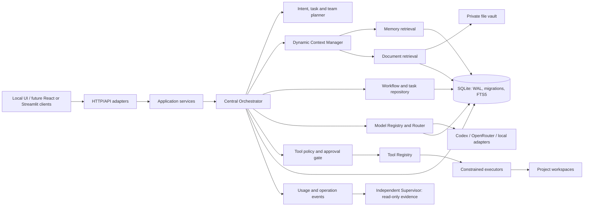

# SAVVA-MASTER-ARCH-001 — Unified AI Platform Architecture

**Status:** Architecture proposal; implementation not started by this WIP  
**Audit date:** 2026-11-20  
**User-specified baseline:** `4bc38f21e9985a5e4da93acb12b2a8c23f1d5c8a`  
**Audited checkout:** `wip/SAVVA-004-FAILOVER-003` at `40ec4d4dc0aa7a711a0e191e791169e4bb455626`  
**Architecture work branch:** `wip/SAVVA-MASTER-ARCH-001`

## 1. Scope and repository truth

The specified baseline exists and is an ancestor of the audited checkout. The checkout was clean at audit start, tracked `origin/wip/SAVVA-004-FAILOVER-003`, and had `origin=https://github.com/wanga1712/SAVVA.git`. The current code snapshot is newer than the specified baseline and includes the failover WIP changes. This document records both SHAs rather than treating them as interchangeable.

The WIP tips do not form one integrated line of development:

| Branch | Tip | Relationship to audited checkout | Audit treatment |
| --- | --- | --- | --- |
| `wip/SAVVA-004-FAILOVER-003` | `40ec4d4` | Audited checkout | Current code evidence |
| `wip/SAVVA-MODEL-BOOTSTRAP-001` | `dd16d92` | Diverges at `1bf35f8` | Separate candidate implementation; do not merge wholesale |
| `wip/SAVVA-PROMPT-CONTEXT-OPTIMIZATION-001` | `a75a880` | Descends from Bootstrap, diverges from audited checkout at `1bf35f8` | Separate candidate implementation; do not merge wholesale |
| `wip/SAVVA-SELFDEV-001` | `2422e23` | Descends from audited checkout at `40ec4d4` | Separate candidate implementation; audit before extending |
| `wip/SAVVA-UI-NEW-CHAT-AND-AUTHORITY-REPAIR-1` | `260f152` | Diverges at `1bf35f8` | Separate candidate implementation; do not merge wholesale |

The Bootstrap, Prompt Context, and UI branch diffs relative to this checkout remove failover/workflow files. Their useful changes must be integrated file by file with tests; merging those branches as-is would regress current failover. The SelfDev branch is based on the failover tip, but is still a separate WIP and is not automatically accepted as part of this architecture.

`docs/SAVVA-004-AUDIT.md` is a historical, dated audit whose opening Git state and some later pending items no longer describe the current checkout. Keep it as historical evidence. This document is the current architecture audit for the snapshot above.

## 2. Current component map

Statuses refer to the audited checkout unless marked `BRANCH ONLY`.

| Capability | Status | Existing code / evidence | Remaining gap |
| --- | --- | --- | --- |
| OpenAI-compatible model adapters | PARTIAL | `savva/agent/models.py`: `ModelAdapter`, `OpenRouterAdapter`, `OllamaAdapter` | One configured OpenRouter/Ollama adapter; no unified capability registry or per-role selection |
| ChatGPT/Codex primary | IMPLEMENTED | `savva/agent/codex_app_server.py` | A primary execution adapter, not a general model catalog or multi-agent runtime |
| Quota failover | IMPLEMENTED (bounded) | `savva/agent/failover.py`, `QuotaSnapshot`, `FailoverEngine` | Covers primary/fallback and quota/budget cases; not general capability routing |
| OpenRouter account/catalog and protected key storage | BRANCH ONLY | Bootstrap branch adds `savva/agent/openrouter.py`, `credentials.py` | Not present in audited checkout; branch also removes current failover/workflow code |
| Agent orchestration | PARTIAL | `savva/agent/orchestrator.py`: one model/tool loop, budget guard, sanitizer | No task hierarchy, durable agent assignment, or multi-agent governance |
| Intent/context routing | BRANCH ONLY | Prompt Context branch adds `savva/agent/context.py`, `prompts.py`, and prompt registry | Not present in audited checkout; branch must be selectively integrated |
| Workflow state and project router | PARTIAL | `savva/agent/workflow.py`: task types, transition graph, JSON `WorkflowStore`, repair cap | Not wired into HTTP chat/orchestrator; router is heuristic and project-root lookup is explicit/static |
| Session/conversation storage | PARTIAL | `savva/server.py`: `SessionStore`, JSON persistence, max 100 sessions; session idempotency/pending operation state | No user identity, project membership, normalized message store, retention policy, or database migrations |
| Project/workspace tools | IMPLEMENTED (bounded) | `savva/agent/projects.py`, `workspace.py`, `tools.py` | One configured workspace root; not a multi-project catalog/ACL manager |
| Approval and file changes | IMPLEMENTED (bounded) | `ProjectService.propose/diff/validate/apply`, `/api/confirm`, `ActionJournal` | Pending proposal bodies are memory-only and expire on restart; approval persistence/actor audit needs durable design |
| Registered tools and permissions | IMPLEMENTED | `savva/core/registry.py`, `permissions.py`, `schemas.py` | `process.execute` and package installation remain reserved; no approved Windows test executor |
| Usage and budget | PARTIAL | `savva/agent/usage.py`: JSONL usage, cost confidence, daily sum; `RunBudget`; failover reservation | Separate task/session/daily concerns; no unified budget reservation ledger across retries and projects |
| Local Tailscale preflight | IMPLEMENTED (optional) | `savva/agent/network.py`, server runtime gate | Egress policy is useful defense-in-depth, not an authorization or privacy boundary by itself |
| Self-development Candidate | BRANCH ONLY | SelfDev branch: manifest, executor, checks, route | Not current checkout; requires independent review and acceptance before reuse |
| New chat repair | BRANCH ONLY | UI repair branch | Not current checkout; it diverges from failover and needs selective integration |
| Memory engine | MISSING | `SessionStore` stores conversation messages only | No typed global/project/agent memory, retrieval, consolidation, or user/project ACL |
| Document intelligence/retrieval | MISSING | No parser/index implementation or dependencies in `pyproject.toml` | No file ingestion, source-location chunks, FTS5 index, OCR pipeline, or retention controls |
| Artifact generation | MISSING | Existing React template proposal only | No general DOCX/XLSX/PDF/PPTX generation adapters or artifact QA |
| Supervisor/reputation | MISSING | No independent audit service or evaluation ledger | No independent policy boundary, evidence-based reputation, or anti-gaming review |
| Project dashboard/UI adapters | PARTIAL | Local HTML/CSS/JS in `savva/web`; project template emits React project | No Streamlit adapter or shared Core client contract for multiple applications |
| Persistent relational storage | MISSING | JSON/JSONL files; standard-library-only package dependencies | No SQLite schema, migrations, WAL policy, backup/restore, or FTS5 repositories |

Multiple provider adapters or tool calls do not make SAVVA multi-agent. Current orchestration is a single model loop. Conversation persistence is not a Memory Engine. Sending file text to a model is not Document Intelligence.

## 3. Target architecture and boundaries

The Central Orchestrator is deterministic control-plane code. Models propose classifications, plans, and content; they do not own workflow state, authorization, budget accounting, storage access, or acceptance status. Global Chief Architect is a planning role invoked through the model-routing interface, not a second privileged service. Project Architect owns project-specific architecture decisions within approved project constraints. Supervisor/Auditor is a separately configured, read-only evaluation service with independent policy and append-only audit output.

### Layer responsibilities

1. **Client adapters:** local HTTP now; future React/Streamlit clients depend on the same SAVVA Core API and never get direct provider, DB, shell, or filesystem authority.
2. **Application services:** chat, project, document, artifact, approval, and settings use cases. Validate user/project scope before dispatch.
3. **Central Orchestrator:** persist operation identity, select workflow, coordinate role calls, enforce state transitions, reservations, retries, and stop conditions. It is the only writer of task state.
4. **Model Registry/Router:** resolve provider/model adapters and capability evidence; keep availability, price, quality, and reliability dimensions separate.
5. **Context/Memory/Retrieval:** create a bounded `ContextPack` from approved, scoped sources; never concatenate an entire repository or document corpus.
6. **Tool policy/execution:** validate typed tool contracts and actor/project grants. Executors enforce root, command, timeout, resource, and output bounds independently of model instructions.
7. **Repositories/storage:** SQLite owns structured state and metadata. A private content-addressed file vault owns large originals and generated artifacts. Provider secrets remain in OS-protected credential storage.
8. **Supervisor:** receives evidence references and redacted diffs/results; cannot call write tools, alter the primary result, or edit its own evaluation record.

Local-only operation is a first-class route: a local-only profile permits only verified local adapters and local storage, prevents remote fallback and outbound document transfer, and reports BLOCKED when local capacity/capabilities are insufficient. Cloud providers remain opt-in adapters; Tailscale is not treated as the data authorization mechanism. The School and waterproofing directions are separate project records using the same project/memory/access contracts, not global special cases.

## 4. Cross-module contracts

These are proposed contracts for sequential WIPs; names are logical boundaries, not a mandate to create every class up front. Reuse current adapters, stores, registries, and services behind interfaces rather than duplicating them.

### Model and routing

- `ModelDescriptor`: provider, model id, provider/version metadata, input/output limits, modalities, tools/structured-output features, price evidence, region/availability evidence, local resource requirements, last verification, and independent test/evaluation records.
- `CapabilityEvidence`: capability, status (`DISCOVERED`, `CATALOG_ONLY`, `VERIFIED`, `DEGRADED`, `UNAVAILABLE`, `NOT_TESTED`), method, timestamp, model/version, and evidence reference. A single timeout updates reliability/health; it does not delete or permanently disqualify a model.
- `ModelRequest`: operation/task/project ids, role, required capabilities, complexity and quality targets, budget reservation, context pack, deadline, and allowed tools.
- `ModelResult`: provider/model/version, response/tool proposals, token counts and confidence, cost and confidence, latency, request id, finish/error classification.
- `ModelSelector.select(request)`: filter by required proven capability and policy first; rank remaining candidates by task quality evidence, availability/region, latency/resource fit, role fit, and then cost. Fallback uses explicit failure classification and budget reservation. Never infer subscription value as per-call dollar cost.

### Context and memory

- `TokenEstimator.count(model, content) -> TokenCount(value, method, confidence)`. Prefer the model tokenizer; otherwise use a conservative documented estimate. Reject a call if the validated context limit plus output reserve and safety margin is exceeded.
- `ContextPack`: ordered messages/fragments, source refs, per-category token accounting, estimator confidence, omissions/compressions, and trace ids. Context assembly changes only the provider copy; canonical messages and source files remain intact.
- `MemoryRecord`: `record_id`, `owner_scope` (`user`, `project`, `agent`, `conversation`), `owner_id`, `kind` (`fact`, `hypothesis`, `decision`, `preference`, `experience`), content/ref, source, valid time, captured time, verification status, confidence, version, sensitivity, retention, and supersedes relation.
- Memory reads require an explicit user/project/agent scope. No search can return records from another owner. Project memory can be shared only through an explicit project membership grant.

### Workflow, tools, documents, and artifacts

- `WorkflowRepository`: create/get/transition/list events; validates the existing state graph, operation idempotency, attempts, budget, approvals, and revision. First implementation may adapt `WorkflowStore`; replacing its storage requires backup/migration/restore acceptance.
- `ToolExecutionRequest`: actor, project, task, registered tool id/version, validated typed arguments, grant and (if needed) approval-event id, deadline, resource limits, idempotency key. LLMs never pass SQL or shell text to storage.
- `ToolExecutionResult`: status, bounded structured output, stdout/stderr references (not unbounded logs), exit code, elapsed/resource use, and evidence refs. The executor is the authority for actual process outcome.
- `DocumentSourceRef`: document/version hash and page, sheet/range, slide, line, or character range. `DocumentChunk` retains extractor/version and trust classification. Citation responses resolve to source references verifiable by the UI.
- `ArtifactRequest/ArtifactResult`: requested format, template, destination project, approval policy, generated artifact hash, format validation and render/smoke evidence. A different format is never silently substituted.

## 5. State ownership and storage plan

| State | Authoritative owner | Present implementation | Target owner / access rule |
| --- | --- | --- | --- |
| Full conversation and operation idempotency | `SessionStore` | `sessions.json` with bounded sessions/messages, pending and last operation state | `ConversationRepository`; preserve original messages; keyed by user and optional project; do not use summarized context as source of truth |
| Workflow task/WIP state | `WorkflowStore` | Separate atomic JSON document; not connected to HTTP chat | `WorkflowRepository`; one task state writer; append state events; conversation stores task refs, not a second task copy |
| File proposals/approval | `ProjectService` + UI | Pending proposal bodies in memory; `ActionJournal` JSONL | `ApprovalRepository`; durable exact diff/hash, actor, scope, decision, timestamp; application must revalidate target hash |
| Provider configuration/secrets | `SettingsStore`, environment, Codex login | Non-secret JSON settings; OS/user environment; Codex session external to SAVVA | `ModelConfigRepository` plus OS credential store; public API omits secret material |
| Model usage/cost | `UsageLogger` / `FailoverEngine` | Append-only JSONL and in-memory task/session reservations | Append-only usage/reservation events; reconciled budget projection; retain verified-vs-estimated metadata |
| Project files and documents | Workspace / project roots | One configured workspace and confined file/proposal operations | Per-project root grants; large bytes in private vault; metadata, hashes, chunks and ACL in DB |
| Model capability and reputation | None integrated | Catalog/verification candidates on Bootstrap branch only | `ModelRepository`, `EvaluationRepository`, `ReputationEvent`; never let reputation grant permissions |

### Proposed SQLite rules

- SQLite with foreign keys enabled, WAL mode, bounded busy timeout, schema version table, ordered migrations, and an automated consistent backup/restore procedure.
- Repository methods are the only SQL entry points. No model, prompt, tool argument, or UI text can specify SQL.
- Add `user_id` and `project_id` scope columns where records are user/project-owned. All reads and deletes enforce scope in the repository; test cross-scope denial.
- Keep large originals outside SQLite in an ACL-confined, content-addressed vault. DB records store opaque relative keys, size, MIME, hash, retention and scan status; no absolute host paths in model context.
- FTS5 indexes normalized text/chunks with owner/project filters. Index deletion follows source deletion. Future vector search implements the same `Retriever` interface and access filters.
- Migrations are additive and reversible where possible. Before any format cutover, snapshot existing JSON/JSONL, migrate to a temporary DB, verify record counts/hashes, then atomically switch with rollback instructions. Do not remove old files until a restore rehearsal passes.

## 6. Security, privacy, and governance invariants

1. Stable/current user workspace roots and production systems are outside self-development write scope. Candidate roots are explicit allowlisted projects.
2. Approval applies to a specific content hash, project, and operation. No model or retry can broaden an approved change.
3. Models never receive secrets, unrestricted SQL/shell, raw credential stores, or unrequested document bodies.
4. External document text is labeled untrusted data and cannot override system policy. No macros, formulas, embedded code, or document links execute during parsing.
5. Default document handling is local. Cloud transfer requires the relevant user consent and scoped excerpts.
6. Per-user and per-project data access is checked on every repository operation; a chat id is not an authorization principal.
7. Budget and resource limits are enforced before paid or expensive work. Unknown price or uncertain quota is a block/approval condition, not a zero-cost assumption.
8. Supervisor/Auditor reads immutable evidence and emits a separate evaluation event. Primary/Project Architect cannot edit supervisor policy, evidence, or prior audit events.
9. Reputation affects ranking and review depth only. It never grants file, network, process, or approval authority.
10. Tailscale preflight is retained where configured, but localhost binding, egress controls, data ACLs, and approval checks remain independent controls.
11. A local-only profile must be enforceable at the adapter and network boundary: remote model failover is disabled, remote document transfer is denied, and an insufficient local model returns BLOCKED instead of silently using cloud.

## 7. Approved facts and proposed decisions

### Confirmed by repository/session

- Python 3.12+ package; current test command is `python -m unittest discover -s tests -v`.
- Current HTTP interface is a local `ThreadingHTTPServer`, HTML/CSS/JS client, and `/api/chat`, `/api/session`, `/api/reset`, `/api/confirm` routes.
- Current adapters include OpenRouter, Ollama, Codex App Server; failover is quota-aware and preserves OpenRouter budget guards.
- Current permissions implement system/workspace read and approval-gated file write. Process execution and package installation are reserved.
- Proposal application verifies expected hashes and remains user-confirmed.
- `pyproject.toml` has no runtime document/database dependencies today.
- User wants local-only operation to remain possible and cloud document transfer to require permission.

### Proposed, requiring architecture acceptance before implementation

- SQLite/WAL/FTS5 as structured-state store and a content-addressed file vault.
- Scope model, schema, retention defaults, backup encryption/location, migration cadence, multi-user identity source, and deletion semantics.
- Model scoring weights and which capability checks count as VERIFIED for each role.
- Whether global chief architect/supervisor are distinct model calls or local models; exact model and cost targets remain configuration/evidence driven.
- Agent reputation scoring formula, review thresholds, and dispute/appeal mechanism.
- Artifact template catalog, supported renderers, and allowed output destinations.
- React/Streamlit client packaging and whether the current UI remains the canonical local client.

No proposal in this section should be treated as an implemented behavior or permission grant.

The detailed boundary decision is recorded in [ADR-001](ADR-001-platform-boundaries.md).

## 8. Migration and rollout

1. **Integration baseline:** choose the latest accepted branch as the integration base after reviewing each existing WIP. Integrate Bootstrap, Prompt Context, UI, and SelfDev changes selectively. Preserve WIP failover tests and approval semantics. No automatic merges.
2. **Contract-first adapters:** add typed interfaces around current adapter, workflow, session, project, usage, and approval code. Keep behavior unchanged and add contract tests before storage replacement.
3. **Storage foundation:** introduce SQLite repositories and migrations alongside the JSON/JSONL stores. Dual-read/compare only for migration validation; define one writer at a time. Migrate sessions, workflow, approvals, and usage incrementally.
4. **Model/context:** import protected key and discovery work; add capability evidence, tokenizer-aware packing, role-aware model selection, and trace attribution. Keep quota failover as the provider adapter's bounded fallback mechanism beneath role routing.
5. **Memory and retrieval:** add typed scopes and local FTS5. Build document ingestion as a local job pipeline with resource limits; citations must resolve to document version and exact location.
6. **Governance/agents/artifacts:** introduce role task contracts and read-only independent review before expanding execution authority. Artifact writers use exact-output approval and deterministic validation.
7. **Controlled execution:** retain proposal/approval path. Add command allowlist only after Windows policy, root isolation, timeout, resource caps, output limits, cancellation, idempotency, and rollback are accepted.
8. **Release gates:** for each WIP run unit/contract tests, full regression, migration/restore tests, security boundary tests, then a disposable Candidate end-to-end scenario. No merge to `main`, deployment, or production access by automation.

## 9. Regression and acceptance rules

- Preserve the exact command `python -m unittest discover -s tests -v`; add targeted modules for new domain contracts without deleting/regrouping existing tests until parity is proven.
- Every behavior change needs regression tests for success, denial, boundary/invalid input, persistence across restart, and idempotent replay where applicable.
- Add a cross-project/user isolation matrix for memory, documents, conversations, proposals, artifacts, and deletion.
- Add migration tests from the actual JSON session/workflow and JSONL usage/action formats; verify backups can restore.
- Model tests use mocks for deterministic quota, routing, and budget cases. Real calls are a separately budgeted acceptance run; test reports separate real from simulated results.
- Document tests include malformed/encrypted input, archive expansion limits, parser timeout/memory cap, source-location fidelity, no execution, and deletion from FTS.
- Executor tests use a disposable Candidate, assert cwd and resolved paths, deny traversal/reparse-point escape, enforce timeout/output/parallelism limits, and capture real exit codes. Stable/production must remain untouched.
- Independent QA tests must prove the reviewer cannot mutate primary output, task state, approvals, or its own policy.
- No PASS claim based only on compilation or model self-report. Attach command, exit code, output/log reference, and artifact/diff hash.

## 10. Decomposition

Sequential WIP plans and acceptance criteria are in:

- [SAVVA-004A — Model Registry & Dynamic Context](../wip/SAVVA-004A-MODEL-REGISTRY-CONTEXT.md)
- [SAVVA-004B — Memory Engine](../wip/SAVVA-004B-MEMORY-ENGINE.md)
- [SAVVA-004C — Document Intelligence & Retrieval](../wip/SAVVA-004C-DOCUMENT-RETRIEVAL.md)
- [SAVVA-004D — Multi-Agent Hierarchy](../wip/SAVVA-004D-MULTI-AGENT-HIERARCHY.md)
- [SAVVA-004E — Reputation & Governance](../wip/SAVVA-004E-REPUTATION-GOVERNANCE.md)
- [SAVVA-004F — Artifact Generation](../wip/SAVVA-004F-ARTIFACT-GENERATION.md)
- [SAVVA-004G — Controlled Execution Engine](../wip/SAVVA-004G-CONTROLLED-EXECUTION.md)

## 11. Acceptance status

**Architecture draft prepared for review.** It maps current code and branch divergence, defines state ownership and proposed contracts, and decomposes implementation into bounded WIPs. No implementation, tests, database migration, dependency installation, deploy, or merge was performed in this architecture WIP. Acceptance of proposed identity, retention, backup, scoring, and model-ranking policies remains open.
